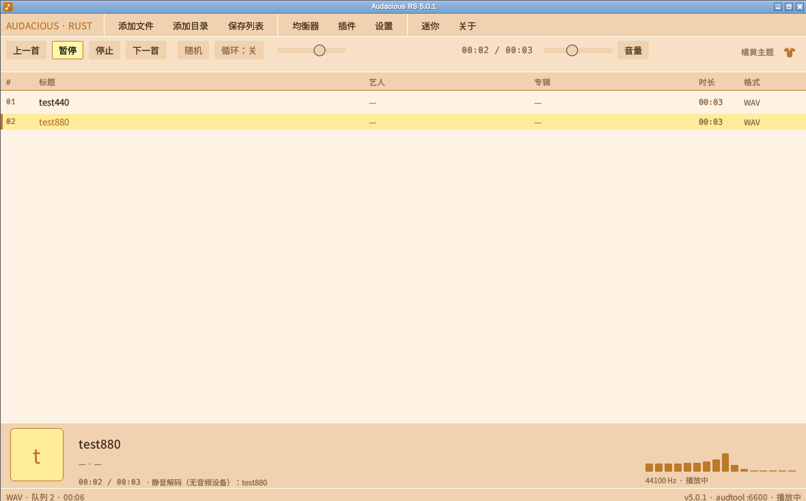
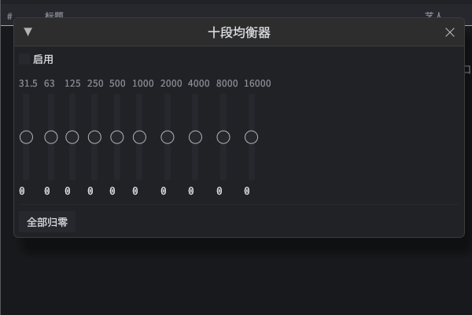

# rust-audacious

Audacious 内核的 Rust 重写。二进制名沿用原版命名：`audacious-rs`（播放器）与 `audtool`（命令行控制）。

[Audacious](https://github.com/hhym/audacious) 内核的 Rust 重写：把原来 C/C++ 的
`libaudcore` + GTK 界面 + `audtool` 三件套，用 Rust 重新实现成一个单二进制的
桌面播放器，界面按 Audacious 的 GTK 主窗口布局排列。



## 现在能做什么

- **播放**：MP3 / FLAC / Ogg Vorbis / Opus / WAV / AAC(M4A) / Matroska 等，解码走
  `symphonia`（经 `rodio`），输出走 `cpal`（WASAPI / ALSA / CoreAudio）
- **播放列表**：多列（# / 标题 / 艺人 / 专辑 / 时长 / 格式）、双击播放、右键菜单
  （播放 / 删除 / 上移 / 下移）、拖文件进窗口、添加目录、M3U / PLS 读写
- **播放控制**：上一首 / 播放暂停 / 停止 / 下一首、进度拖动、音量、随机、循环
  （关 / 列表 / 单曲）、播放结束自动下一首
- **标签**：用 `lofty` 读标题、艺人、专辑、时长、容器格式，缺标签时退回文件名
- **十段均衡器**：31.5Hz–16kHz，每段 ±24dB，播放中实时生效（`biquad` peaking 滤波）
- **频谱**：采样旁路 + Goertzel 频段能量，16 段 log 频谱，信息带里跳动
- **audtool 控制**：本地 TCP 控制协议，25 条命令，脚本可驱动播放器
- **无设备兜底**：机器没有声卡时自动进入静音解码模式，进度、频谱、切歌照常

界面：菜单栏 / 工具栏 / 播放列表 / Now Playing 信息带 / 状态栏，支持深色与浅色、
可改强调色、迷你模式（窗口自动缩成一条 660×150 的信息带）。

| 均衡器 | 迷你模式 |
|---|---|
|  |  |

## 和原版的结构对应

原版是 Meson + C/C++ 的多进程/多 so 架构；Rust 版保持同样的职责切分，
但把它们放进一个 cargo workspace，插件用 trait 而不是 `.so` 动态加载。

| 原版（C/C++） | Rust 版 | 说明 |
|---|---|---|
| `src/libaudcore/playlist.c` | `crates/audcore/src/playlist.rs` | 列表模型、选中/播放索引、随机与循环推进 |
| `src/libaudcore/audconfig.c` | `crates/audcore/src/config.rs` | JSON 配置持久化、时间格式化 |
| `src/libaudtag/*` | `crates/audcore/src/tags.rs` | `lofty` 读标签，扩展名兜底 |
| `src/libaudcore/plugin*.c` | `crates/audcore/src/plugin.rs` | 插件 trait、插件元信息、M3U/PLS 实现 |
| `src/libaudcore/playback.c` + output 插件 | `crates/audacious/src/engine.rs` | 引擎线程、命令/状态快照、rodio 输出、静音兜底 |
| equalizer 插件 | `crates/audacious/src/effects.rs` | 十段 biquad，参数热更新 |
| visualization 插件 | `crates/audcore/src/spectrum.rs` | 环形采样缓冲 + Goertzel |
| `src/audacious/`（GTK UI） | `crates/audacious/src/app.rs` | egui 复刻五段式布局 |
| `src/audtool/` | `crates/audtool/src/main.rs` + `ipc_server.rs` | clap 子命令 ↔ 行分隔 JSON 协议 |

### 有意没做（或换了实现方式）

- **Winamp 2 皮肤**：原版的 `skins` 插件没重写，改用主题配色 + 强调色
- **动态 so 插件**：Rust 侧是编译期注册的 trait，运行期只做开关
- **MPRIS / DBus**：暂时没接，控制通道换成本地 TCP（`control.port`）
- **专辑封面**：还没从标签里抽图，信息带用首字母色块占位
- **ReplayGain、gapless、可视化插件框架**：在路线图里

## 构建与运行

需要 Rust 1.80+（本项目在 1.100 上验证）。Linux 上还需要 `libasound2-dev`、`pkg-config`
和 X11/GL 开发头文件（Debian/Ubuntu：`libasound2-dev pkg-config libx11-dev libgl1-mesa-dev libxkbcommon-dev`）。

```bash
cargo build --release
./target/release/audacious-rs              # 打开界面
./target/release/audacious-rs song.mp3 dir # 启动时把文件/目录入列
./target/release/audacious-rs --headless   # 只跑引擎 + 控制服务，无界面
```

Windows 用 MSVC 工具链即可（`cargo build --release`，无额外系统依赖）；
macOS 需要 Xcode command line tools。

### audtool

```bash
cargo build --release
./target/release/audtool                    # 状态摘要
./target/release/audtool playback-status    # playing / paused / stopped / error
./target/release/audtool current-info       # JSON：title/artist/album/length/position/index
./target/release/audtool playlist-add ~/Music
./target/release/audtool playlist-play 3
./target/release/audtool volume 60
./target/release/audtool eq-gain 5 6        # 第 5 段 +6dB
./target/release/audtool playlist-save ~/list.m3u
./target/release/audtool quit
```

完整子命令：`playback-status current-song current-info playlist-count playlist-song
playlist-play playlist-save playlist-load playlist-add playlist-clear playlist-shuffle
playlist-repeat play-pause play pause stop next previous seek seek-relative get-volume
volume eq-enable eq-gain version quit`。

控制端口写入 `<config>/audacious-rs/control.port`（默认尝试 6600）。

### 快捷键

- `空格` 播放 / 暂停
- `←` `→` 上一首 / 下一首

## 配置文件

```
<config>/audacious-rs/config.json      # 音量、循环、随机、EQ、主题、迷你模式、上次目录
<config>/audacious-rs/control.port     # audtool 连接用的端口
<config>/audacious-rs/playlists/*.m3u  # 「保存列表」默认落点
```

## 测试

```bash
cargo test
```

覆盖：列表推进/删除索引修正、M3U 往返、Goertzel 频段定位、EQ 增益与旁通、
静音解码器的实时推进。共 10 个用例。

## 版本

按习惯从 **5.0** 起标，当前 **5.0.1**（5.0.1 修掉了 Windows 发布版弹出控制台窗口的问题，并把日志写到 `%APPDATA%\audacious-rs\app.log`）（`Cargo.toml` 里统一用 `workspace.package.version`）。

## 许可证

BSD-2-Clause，与原项目一致。UI 布局参考 Audacious 的 GTK 界面，
原项目版权归 Audacious 作者所有，本项目是对其内核思路的独立 Rust 实现。

## 路线图

1. 专辑封面（从标签抽图）+ 歌词面板
2. MPRIS / DBus 接口，Linux 桌面媒体键
3. 可视化插件（VU 表、波形）
4. ReplayGain 与无缝衔接播放
5. 动态插件（`libloading` 加载 `.so`/`.dll`）与插件设置页
