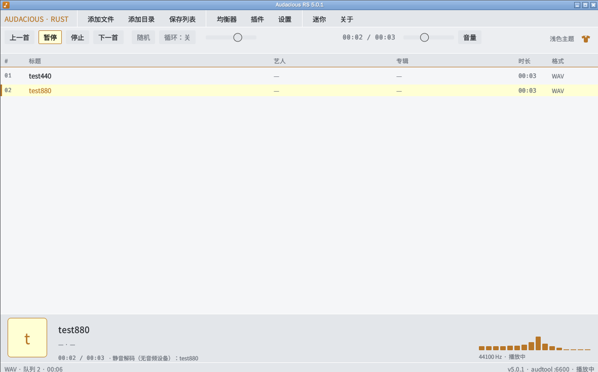
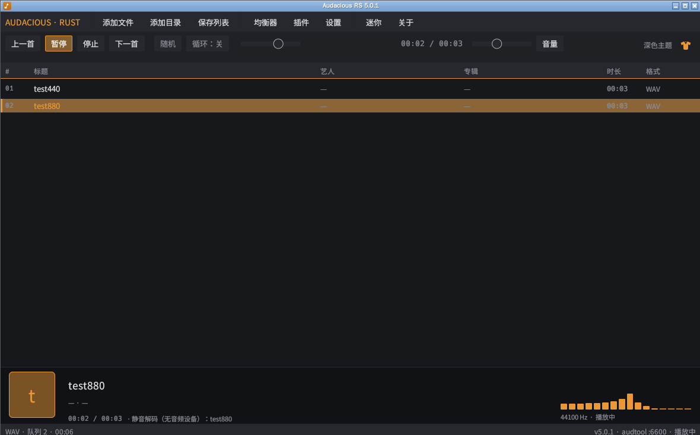
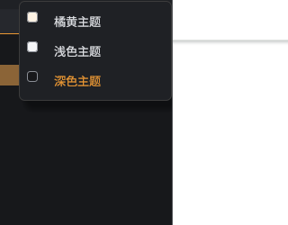
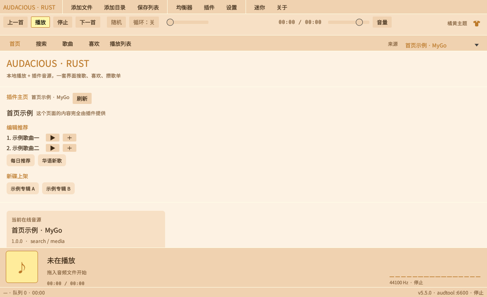
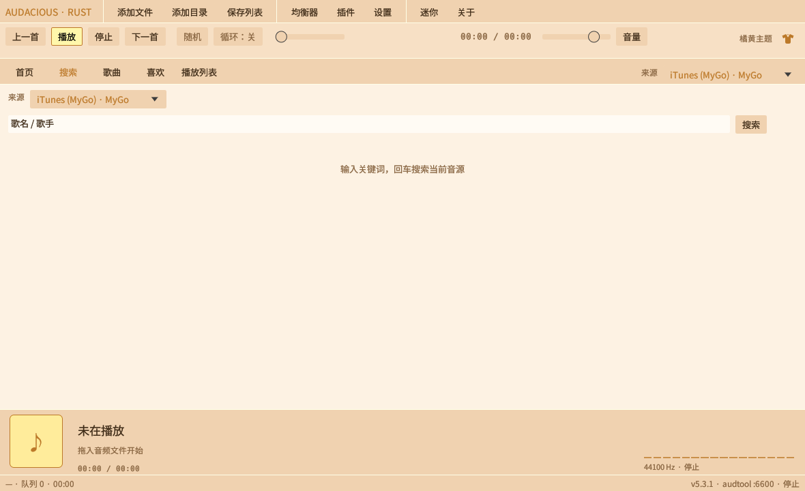
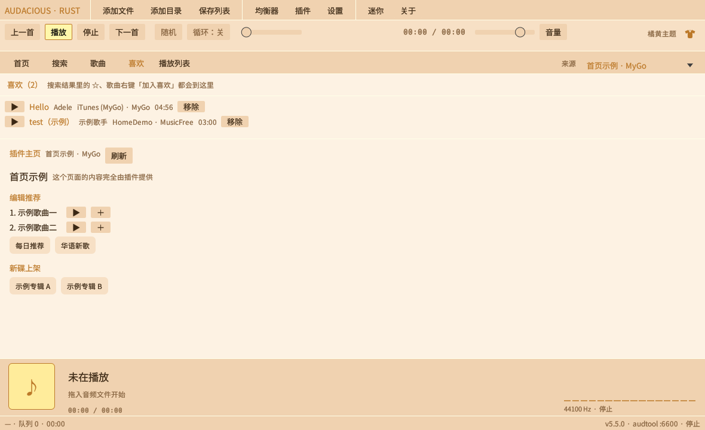
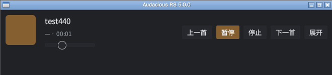
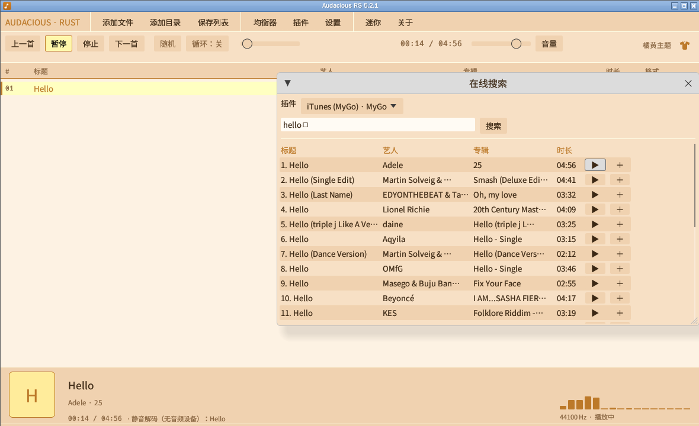

# rust-audacious

Audacious 内核的 Rust 重写。二进制名沿用原版命名：`audacious-rs`（播放器）与 `audtool`（命令行控制）。

[Audacious](https://github.com/hhym/audacious) 内核的 Rust 重写：把原来 C/C++ 的
`libaudcore` + GTK 界面 + `audtool` 三件套，用 Rust 重新实现成一个单二进制的
桌面播放器，界面按 Audacious 的 GTK 主窗口布局排列。


## 现在能做什么

- **播放**：MP3 / FLAC / Ogg Vorbis / Opus / WAV / AAC(M4A) / Matroska 等，解码走
  `symphonia`（经 `rodio`），输出走 `cpal`（WASAPI / ALSA / CoreAudio）
- **播放列表**：多列（# / 标题 / 艺人 / 专辑 / 时长 / 格式）、双击播放、右键菜单
  （播放 / 删除 / 上移 / 下移）、拖文件进窗口、添加目录、M3U / PLS 读写
- **播放控制**：上一首 / 播放暂停 / 停止 / 下一首、进度拖动、音量、随机、循环
  （关 / 列表 / 单曲）、播放结束自动下一首
- **标签**：用 `lofty` 读标题、艺人、专辑、时长、容器格式，缺标签时退回文件名
- **十段均衡器**：31.5Hz–16kHz，每段 ±24dB，播放中实时生效（`biquad` peaking 滤波）
- **频谱**：采样旁路 + Goertzel 频段能量，16 段 log 频谱，信息带里跳动
- **三套主题**：橘黄（默认）、浅色、深色，工具栏右下角「衣服图标」一点即换，配置随存
- **在线插件（MusicFree / MyGo 标准）**：MusicFree 的 `.js` 直接丢进插件目录；MyGo 的插件目录（`plugin.json` + ES 模块）同样丢进去即可。两种标准都会出现在「插件 → 在线插件」和「在线搜索」里，搜到歌点 ▶ 就能直接播放网络音源（详见 [PLUGINS.md](PLUGINS.md)）
- **主面板五个标签**：首页 / 搜索 / 歌曲 / 喜欢 / 播放列表。首页显示当前音源、歌曲与喜欢的数量、快捷入口；
  搜索页直接搜当前音源（结果行有 ▶ / ＋ / ☆）；喜欢页收藏本地和在线歌曲（右键歌曲或搜索结果里的 ☆ 都能加入，
  存在 `<config>/audacious-rs/liked.json`）；播放列表页列出保存过的 M3U，点「载入」或「播放」恢复
- **音源切换**：标签栏右侧显示当前插件名（如 `iTunes (MyGo) · MyGo`），下拉即可切换插件接口
- **audtool 控制**：本地 TCP 控制协议，25 条命令，脚本可驱动播放器
- **无设备兜底**：机器没有声卡时自动进入静音解码模式，进度、频谱、切歌照常

界面：菜单栏 / 工具栏 / 播放列表 / Now Playing 信息带 / 状态栏。三套配色一键切换，
强调色可自定义，支持迷你模式（窗口自动缩成一条 660×150 的信息带）。

| 橘黄（默认） | 浅色 | 深色 |
|---|---|---|
|  |  |  |

工具栏最右侧是主题按钮，图标是一件 T 恤（「换一件衣服」），点开是三选一的小菜单：



主面板：标签栏右侧就是音源选择器。

| 首页 | 搜索 |
|---|---|
|  |  |

| 喜欢 |
|---|
|  |

| 均衡器 | 迷你模式 |
|---|---|
|  |  |

MyGo 标准插件（示例 iTunes）在「在线搜索」里出结果并直接播放：



## 和原版的结构对应

原版是 Meson + C/C++ 的多进程/多 so 架构；Rust 版保持同样的职责切分，
但把它们放进一个 cargo workspace，插件用 trait 而不是 `.so` 动态加载。

| 原版（C/C++） | Rust 版 | 说明 |
|---|---|---|
| `src/libaudcore/playlist.c` | `crates/audcore/src/playlist.rs` | 列表模型、选中/播放索引、随机与循环推进 |
| `src/libaudcore/audconfig.c` | `crates/audcore/src/config.rs` | JSON 配置持久化、时间格式化 |
| `src/libaudtag/*` | `crates/audcore/src/tags.rs` | `lofty` 读标签，扩展名兜底 |
| `src/libaudcore/plugin*.c` | `crates/audcore/src/plugin.rs` | 插件 trait、插件元信息、M3U/PLS 实现 |
| `src/libaudcore/playback.c` + output 插件 | `crates/audacious/src/engine.rs` | 引擎线程、命令/状态快照、rodio 输出、静音兜底 |
| equalizer 插件 | `crates/audacious/src/effects.rs` | 十段 biquad，参数热更新 |
| visualization 插件 | `crates/audcore/src/spectrum.rs` | 环形采样缓冲 + Goertzel |
| `src/audacious/`（GTK UI） | `crates/audacious/src/app.rs` | egui 复刻五段式布局 |
| `src/audtool/` | `crates/audtool/src/main.rs` + `ipc_server.rs` | clap 子命令 ↔ 行分隔 JSON 协议 |
| `plugins/*`（C 插件） | `crates/audplugins` | MusicFree 标准 JS 插件宿主（boa_engine + 自写 polyfill） |

### 有意没做（或换了实现方式）

- **Winamp 2 皮肤**：原版的 `skins` 插件没重写，改用主题配色 + 强调色
- **动态 so 插件**：解码/输出这类内核插件仍是编译期注册的 trait；需要运行期热插拔的是「在线音源」这一类，走 MusicFree 标准的 JS 插件
- **MPRIS / DBus**：暂时没接，控制通道换成本地 TCP（`control.port`）
- **专辑封面**：还没从标签里抽图，信息带用首字母色块占位
- **ReplayGain、gapless、可视化插件框架**：在路线图里

## 构建与运行

需要 Rust 1.80+（本项目在 1.100 上验证）。Linux 上还需要 `libasound2-dev`、`pkg-config`
和 X11/GL 开发头文件（Debian/Ubuntu：`libasound2-dev pkg-config libx11-dev libgl1-mesa-dev libxkbcommon-dev`）。

```bash
cargo build --release
./target/release/audacious-rs              # 打开界面
./target/release/audacious-rs song.mp3 dir # 启动时把文件/目录入列
./target/release/audacious-rs --headless   # 只跑引擎 + 控制服务，无界面
```

Windows 用 MSVC 工具链即可（`cargo build --release`，无额外系统依赖）；
macOS 需要 Xcode command line tools。

### audtool

```bash
cargo build --release
./target/release/audtool                    # 状态摘要
./target/release/audtool playback-status    # playing / paused / stopped / error
./target/release/audtool current-info       # JSON：title/artist/album/length/position/index
./target/release/audtool playlist-add ~/Music
./target/release/audtool playlist-play 3
./target/release/audtool volume 60
./target/release/audtool eq-gain 5 6        # 第 5 段 +6dB
./target/release/audtool playlist-save ~/list.m3u
./target/release/audtool quit
```

完整子命令：`playback-status current-song current-info playlist-count playlist-song
playlist-play playlist-save playlist-load playlist-add playlist-clear playlist-shuffle
playlist-repeat play-pause play pause stop next previous seek seek-relative get-volume
volume eq-enable eq-gain version quit`。

控制端口写入 `<config>/audacious-rs/control.port`（默认尝试 6600）。

### 快捷键

- `空格` 播放 / 暂停
- `←` `→` 上一首 / 下一首

## 配置文件

```
<config>/audacious-rs/config.json      # 音量、循环、随机、EQ、主题、迷你模式、上次目录
<config>/audacious-rs/control.port     # audtool 连接用的端口
<config>/audacious-rs/playlists/*.m3u  # 「保存列表」默认落点
<config>/audacious-rs/plugins/*.js     # MusicFree 标准在线插件
<config>/audacious-rs/plugins/<dir>/   # MyGo 标准插件（含 plugin.json）
<config>/audacious-rs/plugin-cache.json # 插件扫描结果缓存（删掉即强制重扫）
<config>/audacious-rs/mygo-data/<id>/  # MyGo 插件的 dataDir
<config>/audacious-rs/plugin-storage.json  # 插件用到的持久化键值
<cache>/audacious-rs/streams/          # 在线音源下载缓存
```

## 测试

```bash
cargo test
```

覆盖：列表推进/删除索引修正、M3U 往返、Goertzel 频段定位、EQ 增益与旁通、
静音解码器的实时推进、MusicFree 插件加载/cheerio 搜索/取播放地址与歌词、
MyGo 插件的 ES 模块改写/搜索/取地址/歌词/设置项。共 30 个用例。

## 版本

版本号统一在 `Cargo.toml` 的 `workspace.package.version` 维护，按习惯从 **5.0** 起标，当前 **5.6.2**：

- 5.0.0 首个可运行版本
- 5.0.1 修掉 Windows 发布版弹出控制台窗口的问题，日志改写到 `%APPDATA%\audacious-rs\app.log`
- 5.1.0 三套主题（橘黄 / 浅色 / 深色）与工具栏换肤按钮，默认橘黄
- 5.6.2 插件选择改成翻页弹层（每页 8 个、上一页/下一页、点外部收起），插件多了不用再滚一长条；主面板与搜索页共用同一份页码
- 5.6.1 插件返回的 `headers`（Referer / User-Agent / Cookie）随取流请求一起发，修 B 站等需要防盗链的插件「解析成功但播放出错」；在线音源缓存按 url + headers 取指纹，`.m4s` 按 m4a 缓存
- 5.6.0 主面板四个页面打通两套插件：搜索（统一结果表）、首页（MyGo `home` / MusicFree `getTopLists`）、喜欢（两套插件的条目都能回放，页面底部同样显示插件主页）、歌曲页新增「全选 / 取消选择 / 删除所选」批量操作（Ctrl 多选、Shift 连选）
- 5.5.0 MyGo 插件支持扫码登录：导出 `loginQr` / `loginPoll` 的插件会多出「扫码登录」按钮，宿主渲染二维码（PNG/JPEG，支持 data URL 与 http 图片地址）、每 2 秒轮询状态，登录态由插件自己用 `host.storage` 保存
- 5.4.1 两种插件宿主都补上 `AbortController` / `AbortSignal`（`aborted` / `reason` / `addEventListener` / `AbortSignal.abort()` / `AbortSignal.timeout()`，`fetch` 与 `axios` 支持 `signal`），修掉 Bilibili 等插件取播放地址时报 `AbortController is not defined`
- 5.4.0 主面板加五个标签（首页 / 搜索 / 歌曲 / 喜欢 / 播放列表）和音源切换器；喜欢列表跨会话保存，播放列表页可直接载入/播放已保存的 M3U
- 5.3.1 「重新扫描」改为后台扫描：不再执行插件代码、只做语法检查和静态取元信息，结果按「路径+修改时间+大小」缓存到 `plugin-cache.json`，76 个插件首次 3.5 秒、再次 24 毫秒；扫描失败/超时不再拖死窗口，语法错误改为中文提示并显示插件名
- 5.3.0 在线插件支持 MyGo 标准（目录 + `plugin.json` + ES 模块，`search`/`stream`/`lyrics`、`host`/`fetch`/设置项），两种标准在界面里统一展示；新增示例插件 `examples/mygo-plugins/itunes`
- 5.2.1 插件垫片补齐 `CryptoJS.AES`（CBC/ECB + PKCS7）与完整 `big-integer`（含 `modPow`），修掉真实网易插件 `cannot convert null to object at AES` 报错；`require` 模块补 `default` 自引用，兼容 TS 产物 `axios_1.default(...)` 调用
- 5.2.0 MusicFree 标准插件系统（在线搜索 / 取播放地址 / 歌词），在线音源直接播放；解码器换成自带 symphonia 源，修掉 M4A `SeekError` 崩溃

## 许可证

BSD-2-Clause，与原项目一致。UI 布局参考 Audacious 的 GTK 界面，
原项目版权归 Audacious 作者所有，本项目是对其内核思路的独立 Rust 实现。

## 路线图

1. 专辑封面（从标签抽图）+ 歌词面板
2. MPRIS / DBus 接口，Linux 桌面媒体键
3. 可视化插件（VU 表、波形）
4. ReplayGain 与无缝衔接播放
5. 插件设置页（`userVariables` 表单）与榜单 / 专辑 / 歌单类方法
