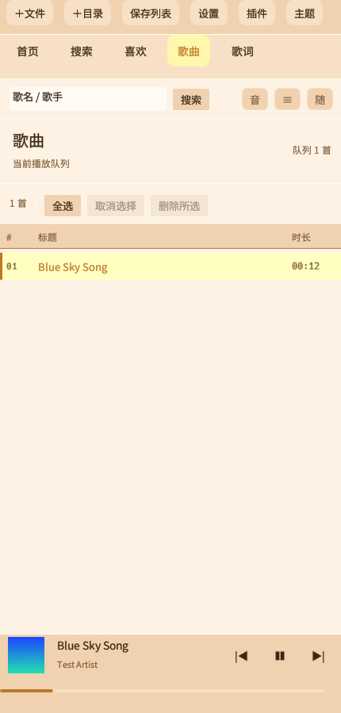

# Android 分支说明（android）

`android` 分支的任务：把 `audacious-rs` 搬到安卓手机上跑。桌面主线（`main`）保持不动，
安卓相关的改动只落在这个分支，成熟后再合回。

当前状态：**P0 完成 + 手机布局可在桌面预览**。arm64 的可安装 APK 已经能编出来
（`dist/rust-audacious-5.18.0-android-arm64.apk`，debug 证书签名），
`android_main` / `ANativeActivity_onCreate` 导出符号、清单、资源、native 库都校验过；
还差真机跑一遍（开发机没有设备/模拟器，adb 装包和首启验证要在手机上做）。

手机布局可以在桌面直接看：

```bash
AUDACIOUS_RS_DATA_DIR=~/.config cargo +stable run -p audacious-rs
# 窗口拉到 430×900，或 设置 → 手机布局 打勾
```



## 一、构建链路（已可用）

```bash
export ANDROID_HOME=$HOME/android-sdk          # platform-34 + build-tools 34 + ndk 26
export JAVA_HOME=/path/to/jdk17                # keytool / apksigner 需要 JDK 17
./scripts/build-android.sh                     # release，产出 dist/rust-audacious-<ver>-android-arm64.apk
./scripts/build-android.sh --debug             # 调试包
```

脚本的做法是**不用 cargo-apk**：`cargo build` → `aapt2 compile/link` →
`zip` 塞 `lib/arm64-v8a/*.so` → `zipalign -p 4` → `apksigner` 签 debug 证书。
原因是 `cargo-apk`（0.10）在 workspace 根清单上会报
`virtual manifests must be configured with [workspace]`，绕不过去。

几点避免踩坑：

- **JDK 17**：`sdkmanager`、`apksigner` 都是 class 61，Java 11 起不来。
- **代理变量**：`HTTP_PROXY` 为空串会让 `sdkmanager` 直接抛 `MalformedURLException`，先 `unset`。
- **NDK 26 默认 4KB 页**：脚本给链接器加了 `-Wl,-z,max-page-size=16384`，兼容 Android 15 的 16KB 页设备。
- **oboe 的 C++ 运行库**：开了 `cpal-shared-stdcxx` 并把 `libc++_shared.so` 一起打进 APK，
  否则 cpal 的 Android 后端一初始化就找不到符号。

## 二、代码层面做了什么

| 项 | 位置 | 说明 |
|---|---|---|
| 共用入口 | `crates/audacious/src/lib.rs` | 桌面 `run()` 与 Android `android_main()` 共用同一套 app/engine；`main.rs` 只剩一行转调 |
| 数据目录 | `audcore::config::data_dir()` | 认 `AUDACIOUS_RS_DATA_DIR`；`android_main` 先把 `Context` 私有目录（`internal_data_path()`）塞进去再 `Config::load()`，拿不到才退回 `/data/data/<pkg>/files` |
| 日志 | `lib.rs::init_logging()` | Android 走 `android_logger`（`adb logcat -s audacious`）+ 私有目录 `app.log` |
| 控制端口 | `ipc_server::serve()` | Android 直接返回 0，不监听 TCP；`handle_client` 等 TCP 代码全部 `cfg(not(android))` |
| 音频后端 | `rodio` 特性 | `cpal-shared-stdcxx` → cpal 走 oboe（AAudio/OpenSL），没有设备时引擎仍退回静音解码 |
| 网络 | `audplugins/Cargo.toml` | 桌面 `native-tls`，Android `rustls-tls`（Android 没有系统 OpenSSL） |
| 依赖特性 | `crates/audacious/Cargo.toml` | 按目标拆 eframe 特性：桌面 `x11/wayland`，Android `android-native-activity` |
| APK 清单 | `android/AndroidManifest.xml` | `NativeActivity` + `android.app.lib_name=audacious_rs`、`uses-sdk 26/34`、媒体权限 |
| 图标 | `android/res/mipmap-*` | 由 `crates/audacious/assets/icon.png` 缩放出的 5 档 launcher 图标 |
| CJK 字体 | `theme::cjk_candidates()` | 已带 `/system/fonts/NotoSansCJK-Regular.ttc` 等 Android 路径 |
| 经典皮肤 | `skin.rs`（含 `Chrome` 双通道）+ `app.rs::classic_view` | 解析 Winamp 2.x `.wsz`（zip 里的位图 + `pledit.txt`），按 275×116 主窗口网格切精灵绘制：背景、进度条、音量、五键控制、随机/循环、EQ/列表开关、`numbers.bmp` 时间、`text.bmp` 文字。设置 → 外观里可开「经典皮肤」并导入 `.wsz`（Android 走 SAF 单文件选择器，桌面把文件放到 `<data>/skins/current.wsz`）。**没装皮肤时走内建橙色经典配色**（`Chrome` 用几何图形画窗口/按钮/槽），手机端默认就进经典界面；另有 windowshade 折叠态、EQ 预设弹层、列表选择/删除/反选 |
| SAF 选文件 | `android.rs` + `android/java/.../MainActivity.java` | 「添加文件」在 Android 上拉起 `ACTION_OPEN_DOCUMENT`（多选音频）；Java 壳把 `onActivityResult` 转给 JNI；回调只做「查文件名 + `openFileDescriptor` + `detachFd`」，真实的读盘拷贝交给 `saf-import` 后台线程，落到 `files/imported/` 后由 UI 取走入列；导入中底部浮层显示百分比 |
| 手机布局 | `app.rs::mobile_mode / mobile_command_bar / mobile_play_bar` | 侧栏变顶部可横滑导航（40px 高），菜单栏/工具栏/状态栏收成一条命令条，播放条换封面+三键+满宽进度；窄屏列表只留 序号/标题/时长 三列、行高 34px；`config.mobile_layout` 或窗口 <700px 自动生效 |

已实测（桌面 430×900 窗口）：导航切换、命令条按钮、播放条播放/暂停/切歌、进度点按 seek、
窄屏三列表格都正常；`cargo test --workspace` 全绿。APK 侧只做了静态校验，真机首启还没跑。

## 三、真机上还要验的（P1）

1. `adb install -r dist/rust-audacious-<ver>-android-arm64.apk`，首启看 `adb logcat -s audacious`
   有没有启动日志与 eframe 报错。
2. SAF 选文件：点「添加文件」→ 选 1 首和多选各试一次，确认底部进度浮层、`files/imported/`
   落盘、列表里能播；导入中界面应保持可操作（拷贝在 `saf-import` 后台线程）。
   已知未处理：选择器里返回的 URI 若已被回收（极少数第三方文件管理器），导入会失败并在
   logcat 留一条 `导入 xxx 失败`。
3. 音频焦点：来电/其他 App 抢占时暂停，接 `AAudio` 的焦点回调。
4. 插件：`boa` + `reqwest(rustls)` 在 arm64 上重跑一遍 `audplugins` 的用例。

## 四、界面（P2）

主结构已完成（见上表「手机布局」）。剩下的是真机细节：

- 底部播放条避开手势条（读 `WindowInsets`），现在是固定高度
- 顶部导航在刘海屏上的安全区内边距
- 按钮最小可点面积统一到 44×44（目前命令条个别按钮偏小）

## 五、打包发布（P3）

- `./scripts/build-android.sh` 出 arm64 单架构包；正式包换自己的 keystore（`ANDROID_DEBUG_KEYSTORE` 可指向别的密钥库）
- GitHub Release 资产：`rust-audacious-<ver>-android-arm64.apk`，与桌面三件套并列

## 六、分支工作流

```bash
git checkout android
# 改代码 → 桌面 cargo test 仍然要绿（不破坏 main 的功能）
cargo test --workspace
./scripts/build-android.sh          # 需要 ANDROID_HOME + JDK 17
git push origin android
```

桌面发布照旧走 `main`：`./scripts/package-windows.sh` + `git archive` + `gh release create`。
